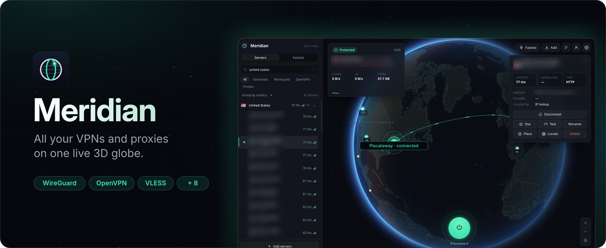
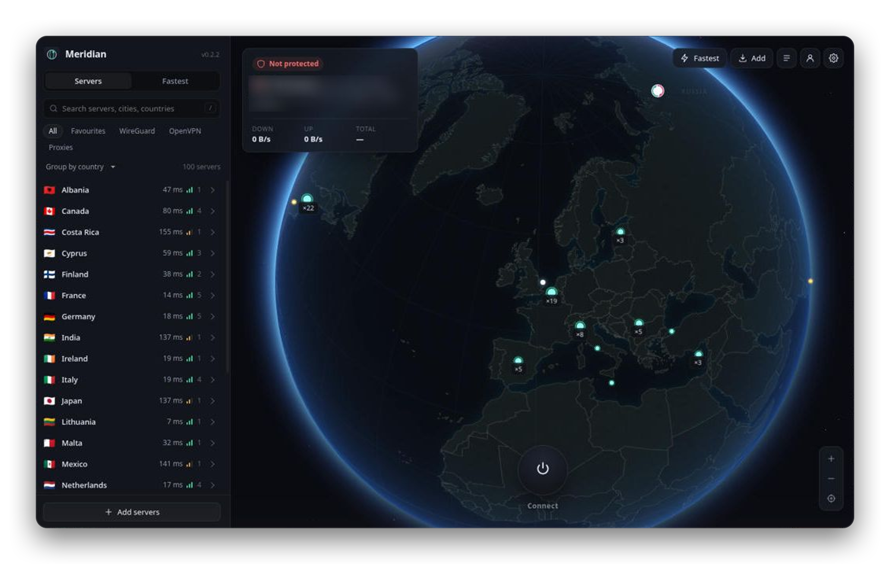

<p align="center">
  
</p>

<p align="center">
  <a href="https://github.com/MagGoTzYT/meridian/releases/latest"></a>
  
  
  
</p>

<p align="center">
  <a href="https://github.com/MagGoTzYT/meridian/releases/latest/download/meridian-linux-x86_64.tar.gz"></a>
  &nbsp;
  <a href="https://github.com/MagGoTzYT/meridian/releases/latest/download/meridian-windows-x86_64.zip"></a>
</p>

<br>

> [!IMPORTANT]
> **Meridian doesn't come with any servers.** It's the app, not a VPN service. Bring your own: a VPN plan you already pay for (Proton, Nord, Mullvad and so on), proxies you rent, or a server you run yourself. Meridian puts them all in one place.

<br>

## What it does

<table>
<tr>
<td width="33%" valign="top"><br><b>Live 3D globe</b><br><sub>Every server pinned on a real map with day and night. Watch the route draw from you to where you connect.</sub></td>
<td width="33%" valign="top"><br><b>Any provider</b><br><sub>Drop in config files, links, subscriptions or a plain proxy list. Meridian works out the rest, including where each server is.</sub></td>
<td width="33%" valign="top"><br><b>Find the fastest</b><br><sub>Real latency and download tests through each server, ranked in a leaderboard. One click connects to the quickest.</sub></td>
</tr>
<tr>
<td width="33%" valign="top"><br><b>Leak alarm</b><br><sub>Meridian checks what the internet sees after you connect, and warns you if it's still your home address.</sub></td>
<td width="33%" valign="top"><br><b>End-to-end encrypted sync</b><br><sub>Optional account to share your servers between computers. Encrypted on your device; the sync server can't read it.</sub></td>
<td width="33%" valign="top"><br><b>Whole system or just apps</b><br><sub>Route everything through the tunnel, or only apps that follow the system proxy. Your choice in Settings.</sub></td>
</tr>
</table>

<br>

<p align="center"></p>

## Bring your own servers

Meridian accepts all of these. Drag files onto the window, paste text, or add a subscription URL.

| What you have | Format | Typical source |
|---|---|---|
| **WireGuard** | `.conf` file | Proton VPN, Mullvad, Surfshark, IVPN, your own server |
| **OpenVPN** | `.ovpn` file, or a `.zip` with its certificates | NordVPN, Proton VPN, VPN Unlimited, PIA, Windscribe |
| **Share links** | `vless://` `vmess://` `trojan://` `ss://` `hysteria2://` `hy2://` `tuic://` `anytls://` `socks5://` `http://` `wireguard://` | Throne, NekoBox, v2rayN users |
| **Subscription URL** | `https://…` returning links (plain or base64), Clash YAML or sing-box JSON | Your proxy panel or provider |
| **Proxy list** | one per line: `ip:port:user:pass`, `user:pass@ip:port` or `ip:port` | Rented proxies (e.g. Webshare) |
| **Config files** | Clash / Mihomo `.yaml`, sing-box `.json` | Existing setups |
| **Zip** | any mix of the above | Provider "download all" bundles |

<sub>Not supported: Xray-only transports such as <code>xhttp</code>, and Xray JSON configs.</sub>

<details>
<summary><b>Where do I get config files from my VPN provider?</b></summary>
<br>

- **Proton VPN** — account page → Downloads → WireGuard, or OpenVPN with your OpenVPN credentials
- **NordVPN** — OpenVPN files from nordvpn.com/ovpn; sign in with your *service* credentials, not your email
- **Mullvad** — Account → WireGuard configuration → download
- **VPN Unlimited** — KeepSolid User Office → manual configuration
- **Surfshark** — Manual setup → WireGuard or OpenVPN
- **Others** — look for "manual setup" or "config files" in your account

</details>

## Install

**Linux** (tested on Arch, KDE)

```bash
sudo pacman -S sing-box          # add openvpn / wireguard-tools if you use those
tar xzf meridian-linux-x86_64.tar.gz && cd meridian
./install.sh
```

Open **Meridian** from your app menu. In **Settings**, press **Fix** next to *TUN access* once, and it stops asking for your password on every connect.

<details>
<summary><b>Other Linux distros</b></summary>
<br>
Install <code>sing-box</code> with your package manager (or from its releases page), then run <code>./install.sh</code>. No root needed for the install itself.
</details>

<details>
<summary><b>Windows (preview)</b></summary>
<br>
Unzip, put <code>sing-box.exe</code> next to <code>meridian.exe</code>, and run Meridian as administrator. Windows support is still being tested.
</details>

## Privacy

- Runs on your computer. The window only talks to Meridian itself, on your machine.
- No accounts required, no tracking, no analytics, no ads.
- Sync is optional and end-to-end encrypted (PBKDF2 · HKDF · AES-256-GCM). If you forget your password, the synced copy can't be recovered, by anyone.

<br>

<p align="center"><sub>© 2026 MagGoTzYT · All rights reserved · Free to download and use</sub></p>
